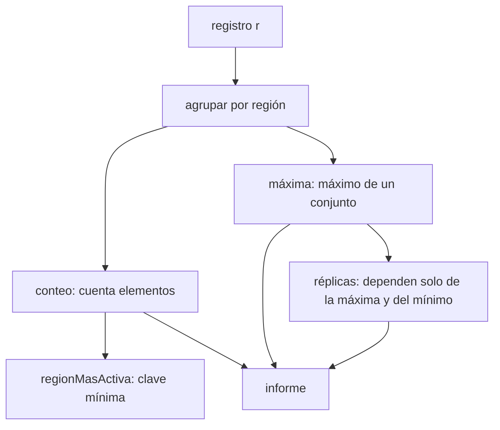

# Corrección — Taller 3

## Notación

- Un registro es una lista $r = [s_1, \dots, s_n]$ de sismos. De cada sismo $s$
  me interesan su región $\rho(s)$ y su magnitud $\mu(s)$.
- $R(r) = \{\rho(s) : s \in r\}$ es el conjunto de regiones que aparecen en $r$.
- $r_g$ es la sublista de los sismos de la región $g$, en el mismo orden que
  tienen en $r$.
- $N_g(r) = \lvert r_g \rvert$ es el número de sismos de la región $g$.
- Si $g \in R(r)$, $M_g(r) = \max \{\mu(s) : s \in r_g\}$ es su magnitud máxima.
- $x \cdot t$ es la lista con primer elemento $x$ y resto $t$. $[\,]$ es la lista
  vacía y $l_1 \mathbin{+\!+} l_2$ es pegar dos listas.
- $r' \sim r$ quiere decir que $r'$ es una permutación de $r$: tiene los mismos
  sismos, con las mismas repeticiones, en otro orden.
- Dos mapas son iguales si tienen las mismas llaves y el mismo valor en cada
  llave. El orden en que se listan las llaves no cuenta.

## Lemas sobre listas: qué significa un `for`

### Lema 1: un generador y una condición

Las funciones `filter` y `map` se definen por casos sobre la lista:

$$\mathrm{filter}(c, [\,]) = [\,] \qquad
\mathrm{filter}(c, x \cdot t) = \begin{cases}
x \cdot \mathrm{filter}(c, t) & \text{si } c(x) \\
\mathrm{filter}(c, t) & \text{si no}
\end{cases}$$

$$\mathrm{map}(e, [\,]) = [\,] \qquad \mathrm{map}(e, x \cdot t) = e(x) \cdot \mathrm{map}(e, t)$$

Para $l = [x_1, \dots, x_n]$, la expresión
`for (x <- l if c(x)) yield e(x)`, que el compilador traduce a
$\mathrm{map}(e, \mathrm{filter}(c, l))$, es la lista

$$[\, e(x_i) : c(x_i) \,]$$

recorrida en orden creciente de $i$: un elemento por cada $x_i$ que cumple $c$,
en el mismo orden de $l$.

*Demostración, por inducción sobre $n$.*

- **Caso base** $n = 0$: $\mathrm{filter}(c, [\,]) = [\,]$ y $\mathrm{map}(e, [\,]) = [\,]$.
  Es la lista vacía, que es lo que dice la afirmación.
- **Paso** $l = x_1 \cdot t$. Si $c(x_1)$ es verdadero, el filtro deja $x_1$ al
  frente y $\mathrm{map}$ produce $e(x_1)$ seguido de lo que produce para el
  resto, que por hipótesis de inducción es $[e(x_i) : i \geq 2,\ c(x_i)]$. Si
  $c(x_1)$ es falso, $x_1$ no aporta nada y el resultado es el del resto, que por
  hipótesis es lo que dice la afirmación. $\blacksquare$

### Lema 2: dos generadores

$$\mathrm{flatMap}(f, [\,]) = [\,] \qquad
\mathrm{flatMap}(f, x \cdot t) = f(x) \mathbin{+\!+} \mathrm{flatMap}(f, t)$$

`for { x <- l1; y <- l2; if c(x, y) } yield e(x, y)` se traduce a
$\mathrm{flatMap}(x \mapsto \mathrm{map}(e(x, \cdot), \mathrm{filter}(c(x, \cdot), l_2)), l_1)$
y es la lista de los $e(x_i, y_j)$ para todas las parejas $(i, j)$ que cumplen
$c$, ordenadas primero por $i$ y luego por $j$.

*Demostración, por inducción sobre la longitud de $l_1$.* Con $l_1 = [\,]$ el
resultado es $[\,]$. Con $l_1 = x_1 \cdot t$, el resultado es lo que produce
$x_1$ con toda $l_2$ (que por el lema 1 son los $e(x_1, y_j)$ con $c(x_1, y_j)$,
en orden de $j$) pegado delante de lo que producen los demás, que por hipótesis
de inducción tiene la forma pedida. $\blacksquare$

## Punto 1: consultas con `for`

### `fuertes`

`for (s <- r if s.magnitud > umbral) yield s.region` es el lema 1 con
$c(s) = (\mu(s) > u)$ y $e(s) = \rho(s)$. Entonces

$$\mathrm{fuertes}(r, u) = [\,\rho(s_i) : \mu(s_i) > u\,]$$

De aquí salen las tres propiedades que pide el enunciado:

- Hay **un elemento por cada sismo** que supera el umbral, así que los
  repetidos no se quitan.
- El **orden** es el del registro.
- El umbral es **estricto**: un sismo con $\mu(s) = u$ no entra.

Con el registro vacío el resultado es $[\,]$.

### `enRegion`

Es el lema 1 con $c(s) = (\rho(s) = g)$ y $e(s) = \mu(s)$:

$$\mathrm{enRegion}(r, g) = [\,\mu(s_i) : \rho(s_i) = g\,]$$

Si $g \notin R(r)$ ningún sismo cumple la condición y el resultado es $[\,]$.

### `paresCercanos`

Sea $d$ el valor `dif` y sea

$$C(a, b) \iff \exists\, x, y \in r :\ \rho(x) = a,\ \rho(y) = b,\ \lvert \mu(x) - \mu(y) \rvert \leq d$$

la propiedad "las regiones $a$ y $b$ tienen un sismo cada una con magnitudes a
distancia $d$ o menos".

**1. `hayCercanos(a, b)` equivale a $C(a, b)$.** Por el lema 2, el `for` con dos
generadores y la condición produce un `1` por cada pareja de sismos $(x, y)$
que cumple $\rho(x) = a$, $\rho(y) = b$ y $\lvert \mu(x) - \mu(y) \rvert \leq d$.
La lista es no vacía (`nonEmpty`) exactamente cuando existe al menos una pareja
así, que es $C(a, b)$.

**2. $C$ es simétrica.** Como $\lvert \mu(x) - \mu(y) \rvert = \lvert \mu(y) - \mu(x) \rvert$,
intercambiar los papeles de $x$ e $y$ muestra que $C(a, b) \iff C(b, a)$.

**3. Las regiones y las parejas.** Sea $G = [g_0, \dots, g_{k-1}]$ la lista de
regiones distintas en orden de primera aparición, que es lo que producen el `for`
sobre $r$ (lema 1) y `distinct`. El resultado, por el lema 2, es

$$P = [\,(g_i, g_j) : i < j,\ C(g_i, g_j)\,]$$

ordenado por $i$ y luego por $j$, porque `drop(i + 1)` deja solo las regiones
$g_{i+1}, \dots, g_{k-1}$.

**Propiedades de $P$:**

- *No hay parejas de una región consigo misma:* si $i < j$ entonces $g_i \neq g_j$,
  porque $G$ no tiene repetidos.
- *Cada pareja sale una sola vez:* la pareja $(g_i, g_j)$ queda determinada por
  $(i, j)$, y solo se generan con $i < j$. Nunca aparece también $(g_j, g_i)$.
- *Es completa:* si dos regiones distintas $a$ y $b$ cumplen $C(a, b)$, una de
  las dos aparece antes en $G$; por la simetría, $C$ se cumple en ese orden y
  la pareja está en $P$.
- *Es correcta:* toda pareja de $P$ cumple $C$ por la condición del `for`.

Por tanto $P$ contiene exactamente las parejas de regiones distintas con
$C$, una sola vez cada una y en orden de aparición.

**Comprobación con el registro del enunciado.** Valle y Santander tienen
$\lvert 5.3 - 5.1 \rvert = 0.2$. Valle y Choco tienen como menor diferencia 0.7
(las magnitudes 3.8 y 3.1, o 5.3 y 6.0). Santander y Choco tienen como menor
diferencia 0.9 (5.1 y 6.0). Con $d = 0.6$ solo cumple Valle y Santander. Con
$d = 1.0$ cumplen las tres parejas. Con $d = 0.1$ no cumple ninguna. Es lo que
dice el enunciado.

## Punto 2: agrupar con mapas

### `porRegion`

`groupBy(s => s.region)` pone cada sismo $s$ en el grupo de la llave $\rho(s)$
y conserva el orden de $r$ dentro de cada grupo. Por eso:

$$\mathrm{porRegion}(r)(g) = r_g \quad \text{para todo } g \in R(r)$$

Las llaves del mapa son exactamente $R(r)$, y ningún grupo está vacío, porque
una llave solo se crea cuando aparece un sismo con esa región. Las regiones que
no están en el registro no aparecen. Con $r = [\,]$ el mapa es vacío.

### `conteoPorRegion`

`porRegion(r).map { case (g, l) => (g, l.length) }` cambia cada lista por su
longitud y deja la misma llave. Como las llaves no cambian, no se juntan dos
entradas en una: no se pierde ninguna región. Entonces

$$\mathrm{conteoPorRegion}(r)(g) = \lvert r_g \rvert = N_g(r) \quad \text{para } g \in R(r)$$

### `magnitudMaxima`

Análogamente, cambia cada lista por la mayor de sus magnitudes:

$$\mathrm{magnitudMaxima}(r)(g) = \max \{\mu(s) : s \in r_g\} = M_g(r)$$

El máximo está bien definido porque $r_g$ es no vacío para toda llave $g$.
Por eso `max` nunca se aplica a una lista vacía.

## Punto 3: consultas seguras

### `conteoSeguro`

`withDefaultValue(0)` agrega al mapa una respuesta por defecto sin cambiar
sus llaves. Para **toda** región $g$, exista o no en el registro:

$$\mathrm{conteoSeguro}(r)(g) = N_g(r)$$

Si $g \in R(r)$ es el valor del mapa. Si $g \notin R(r)$ no hay sismos suyos,
$r_g = [\,]$ y $N_g(r) = 0$, que es el valor por defecto. La función es total:
no lanza excepción para ninguna región.

### `maximaDe`

`get(g)` devuelve `Some` del valor si la llave existe y `None` si no. Como
$g \in R(r)$ si y solo si $r_g \neq [\,]$:

$$\mathrm{maximaDe}(r, g) = \begin{cases}
\mathrm{Some}(M_g(r)) & \text{si } r_g \neq [\,] \\
\mathrm{None} & \text{si } r_g = [\,]
\end{cases}$$

### `regionMasActiva`

Si $r = [\,]$, el mapa de conteo es vacío, la lista queda vacía, `headOption` da
`None` y el resultado es `None`.

Si $r \neq [\,]$, a cada región $g \in R(r)$ le asigno la clave $k_g = (-N_g, g)$,
comparada primero por el número y, si empatan, por el nombre en orden
alfabético. `sortBy` ordena la lista de menor a mayor clave y `headOption`
toma la primera, que es la de **clave mínima**.

- Las claves son **todas distintas**, porque dos regiones distintas tienen
  nombre distinto. Así la lista ordenada es única, sin ningún empate que
  resolver.
- La clave mínima la tiene la región con mayor $N_g$ (porque el signo menos
  invierte el orden). Entre las que empatan en $N_g$, gana la de menor nombre.

Por tanto, con $A = \{g \in R(r) : N_g = \max_h N_h\}$:

$$\mathrm{regionMasActiva}(r) = \mathrm{Some}(\min A)$$

donde $\min$ es el orden alfabético. Es lo que pide el enunciado.

## Punto 4: réplicas perezosas

Sea $x$ la magnitud inicial. Sin redondear, la sucesión es

$$a_0 = x \qquad a_{k+1} = 0.8 \cdot a_k \qquad \text{es decir} \qquad a_k = x \cdot 0.8^{k}$$

y la secuencia que produce `replicas` es $b_k = \mathrm{redondear}(a_k)$, con
$\mathrm{redondear}(v) = \mathrm{Math.round}(100 v) / 100$. `LazyList.iterate`
genera los $a_k$ y `map` los redondea. El redondeo se aplica al final de cada
valor, no entre un paso y el siguiente, para que el error no se acumule.

### `replicas`

El primer elemento es $b_0 = \mathrm{redondear}(x)$, que es $x$ cuando $x$ tiene
a lo sumo dos decimales. Cada elemento es el 80 % del anterior, salvo el
redondeo. Con $x = 5.0$:

$$a_0 = 5.0,\quad a_1 = 4.0,\quad a_2 = 3.2,\quad a_3 = 2.56$$

### `replicasSensibles`

**Propiedad 1: la sucesión no crece.** Si $x \geq 0$, como $0 < 0.8 < 1$ se
tiene $a_{k+1} \leq a_k$. Redondear es una función monótona, o sea que si
$u \leq v$ entonces $\mathrm{redondear}(u) \leq \mathrm{redondear}(v)$. Por eso

$$b_0 \geq b_1 \geq b_2 \geq \cdots$$

**Propiedad 2: el conjunto de réplicas que superan el mínimo es un prefijo.**
Sea $m$ el mínimo. Si $b_k > m$ y $j < k$, entonces $b_j \geq b_k > m$ por la
propiedad 1. Así que el conjunto $\{k : b_k > m\}$ tiene la forma
$\{0, 1, \dots, K - 1\}$ para algún $K \geq 0$.

**Propiedad 3: termina.** Como $a_k \to 0$, existe $k_0$ con $a_k < 0.005$ para
todo $k \geq k_0$, y entonces $b_k = 0$. Si $m \geq 0$, la condición $b_k > m$ falla
desde ahí y $K$ es finito. Por eso `replicasSensibles` se usa con un mínimo
mayor o igual que cero.

**Conclusión.** `takeWhile(m => m > minimo)` se detiene en el primer índice que
no cumple, que es $K$. Gracias a la propiedad 2, eso es **exactamente** lo mismo
que quedarse con todas las réplicas que superan el mínimo:

$$\mathrm{replicasSensibles}(x, m) = [\, b_0, b_1, \dots, b_{K-1} \,]$$

Con $x = 5.0$ y $m = 3.0$: $b = 5.0, 4.0, 3.2, 2.56$, así que $K = 3$ y el
resultado es $[5.0, 4.0, 3.2]$. Con $x = 2.0$ y $m = 3.0$: $b_0 = 2.0$ ya no
supera 3.0, entonces $K = 0$ y el resultado es $[\,]$.

### Cuántos elementos se calculan

Por ser perezosa, la secuencia solo calcula los elementos que se piden:

- `take(n)` calcula exactamente $n$ elementos.
- `replicasSensibles` calcula $K + 1$ elementos: los $K$ que entran y el primero
  que no cumple, que hay que calcular para saber que ya no cumple.

El resto de la secuencia infinita queda sin calcular, así que la memoria usada
crece con $K$ y no con el tamaño de la secuencia.

## Punto 5: informe combinado

Las llaves de `conteoPorRegion(r)` y de `magnitudMaxima(r)` son las dos
$R(r)$, porque ambos salen de `porRegion`. Entonces consultar
`maximas(region)` para cada llave de `conteo` siempre encuentra la llave. Sea

$$L(x, m) = \lvert \mathrm{replicasSensibles}(x, m) \rvert = K$$

el número de réplicas de magnitud inicial $x$ que superan el mínimo $m$. El
resultado de `informe` es el mapa

$$\mathrm{informe}(r, m)(g) = \mathrm{Resumen}\big(N_g(r),\ M_g(r),\ L(M_g(r), m)\big) \quad \text{para } g \in R(r)$$

con llaves exactamente $R(r)$. Con $r = [\,]$ no hay llaves y el resultado es el
mapa vacío. Como $\mathrm{replicasSensibles}$ es una lista finita, calcular
su longitud no materializa nada de más.

**Comprobación** con el registro del enunciado y $m = 3.0$:

| Región | $N_g$ | $M_g$ | Réplicas que superan 3.0 | $L$ |
|---|---|---|---|---|
| Valle | 3 | 5.3 | 5.3, 4.24, 3.39 | 3 |
| Santander | 2 | 5.1 | 5.1, 4.08, 3.26 | 3 |
| Choco | 2 | 6.0 | 6.0, 4.8, 3.84, 3.07 | 4 |

## El resultado no depende del orden de recorrido

La idea es que ninguna de estas funciones
tiene un estado que se vaya modificando durante el recorrido: cada una se
define con operaciones sobre **toda** la colección (contar, tomar el máximo,
agrupar), no con pasos que dependan de qué sismo se vio primero.

**Teorema.** Sea $r' \sim r$, o sea una permutación del registro. Entonces:

1. $R(r') = R(r)$, $N_g(r') = N_g(r)$ y $M_g(r') = M_g(r)$ para toda región $g$.
2. `conteoPorRegion`, `magnitudMaxima`, `conteoSeguro`, `maximaDe`,
   `regionMasActiva` e `informe` dan el **mismo resultado** para $r$ y para $r'$.
3. `fuertes`, `enRegion` y `paresCercanos` dan los **mismos elementos** (con las
   mismas repeticiones); solo puede cambiar el orden en que se listan.

*Demostración.*

**(1) Conteos, máximos y regiones.** Con el corchete que vale 1 si la
condición es cierta y 0 si no:

$$N_g(r) = \sum_{i=1}^{n} \big[\rho(s_i) = g\big]$$

Una permutación solo reordena los sumandos, y la suma de enteros es
conmutativa y asociativa, así que el total no cambia. Para el máximo:

$$M_g(r) = \max \{\mu(s) : s \in r_g\}$$

es el máximo de una colección finita, y $\max(u, v) = \max(v, u)$ y
$\max(u, \max(v, w)) = \max(\max(u, v), w)$, así que tampoco depende del orden.
El conjunto $R(r)$ tiene los mismos elementos en cualquier orden.

Esto no tiene errores de redondeo: los conteos son enteros y el máximo no hace
aritmética, solo elige. Si se hubiera sumado decimales, el orden sí podría
cambiar el último dígito.

**(2) Las funciones de mapas.** Los mapas son iguales si tienen las mismas llaves
y el mismo valor por llave, sin importar el orden en que se listen. Por el
punto 2, $\mathrm{conteoPorRegion}(r)$ es la función $g \mapsto N_g(r)$ sobre
$R(r)$ y $\mathrm{magnitudMaxima}(r)$ es $g \mapsto M_g(r)$. Por (1), son iguales
para $r$ y $r'$. Con el mismo argumento:

- `conteoSeguro` es $g \mapsto N_g(r)$ para toda $g$.
- `maximaDe` depende solo de $r_g$ vacío o no, y de $M_g(r)$.
- `informe` depende solo de $N_g$, $M_g$