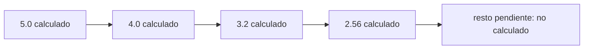
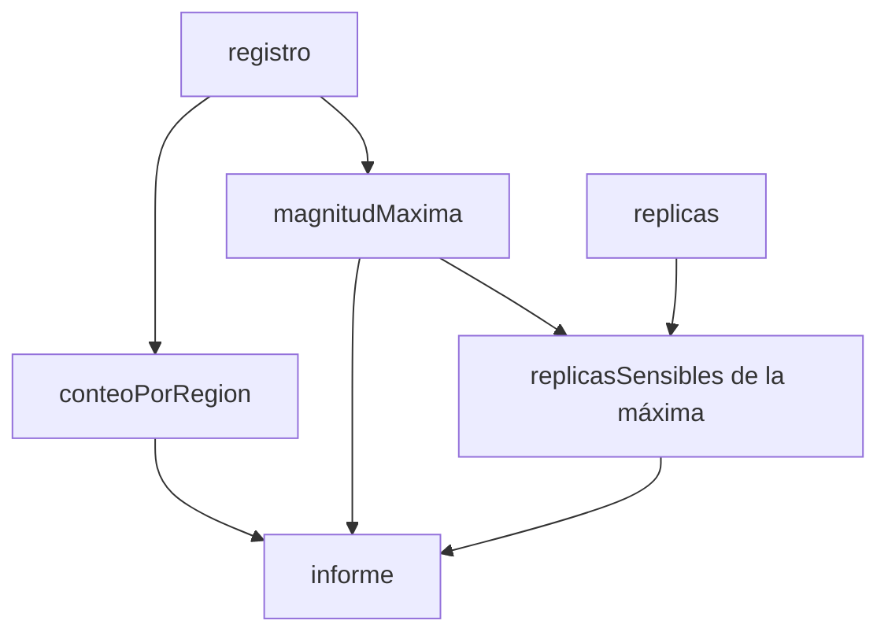

# Proceso — Taller 3

Para las trazas uso el registro del enunciado, con los sismos numerados:

| N.º | Fecha | Región | Magnitud | Profundidad |
|---|---|---|---|---|
| S1 | 2025-3 | Valle | 4.2 | 30 |
| S2 | 2025-3 | Santander | 5.1 | 150 |
| S3 | 2025-4 | Valle | 3.8 | 25 |
| S4 | 2025-4 | Choco | 6.0 | 40 |
| S5 | 2025-5 | Santander | 4.7 | 160 |
| S6 | 2025-5 | Valle | 5.3 | 35 |
| S7 | 2025-6 | Choco | 3.1 | 20 |

## Como se traduce una expresión `for`

Una expresión `for` con `yield` **no es un ciclo**: produce una colección
nueva, y el compilador la reescribe como llamadas a `map`, `flatMap` y
`withFilter` (que se comporta como `filter`).

| Lo que escribo en el `for` | En que se traduce |
|---|---|
| Un generador `x <- lista` con `yield e` | `lista.map(x => e)` |
| Una condición `if c` | `withFilter(x => c)` |
| Dos generadores seguidos `x <- l1` y `y <- l2` con `yield e` | `l1.flatMap(x => l2.map(y => e))` |

Ejemplo: `for (x <- List(1, 2, 3, 4) if x > 2) yield x * 10` se traduce a
`List(1, 2, 3, 4).withFilter(x => x > 2).map(x => x * 10)` y da `List(30, 40)`.

## Punto 1: consultas con expresiones `for`

### `fuertes`

```scala
for (s <- r if s.magnitud > umbral) yield s.region
```

Se traduce a `r.withFilter(s => s.magnitud > umbral).map(s => s.region)`:
primero deja pasar los sismos que superan el umbral y luego se queda con su
región. No quita repetidos y conserva el orden del registro.

Traza de `fuertes(registro, 5.0)`:

| Sismo | Región | Magnitud | ¿Supera 5.0? | Sale |
|---|---|---|---|---|
| S1 | Valle | 4.2 | no | |
| S2 | Santander | 5.1 | sí | Santander |
| S3 | Valle | 3.8 | no | |
| S4 | Choco | 6.0 | sí | Choco |
| S5 | Santander | 4.7 | no | |
| S6 | Valle | 5.3 | sí | Valle |
| S7 | Choco | 3.1 | no | |

Resultado: `List("Santander", "Choco", "Valle")`.

### `enRegion`

```scala
for (s <- r if s.region == region) yield s.magnitud
```

Se traduce a `r.withFilter(s => s.region == region).map(s => s.magnitud)`:
deja los sismos de esa región y se queda con su magnitud.

Traza de `enRegion(registro, "Valle")`: pasan S1, S3 y S6, y salen sus
magnitudes: `List(4.2, 3.8, 5.3)`. Con `"Amazonas"` ningún sismo pasa el
filtro y el resultado es `List()`.

### `paresCercanos`

Esta función usa tres expresiones `for`.

**1. Las regiones distintas, en orden de aparición:**

```scala
val regiones = (for (s <- r) yield s.region).distinct
```

El `for` se traduce a `r.map(s => s.region)` y `distinct` quita los repetidos
conservando el primero de cada uno. Con el registro: `List(Valle, Santander, Choco)`.

**2. `hayCercanos(a, b)`: ¿hay un sismo de `a` y otro de `b` con magnitudes
a distancia `dif` o menos?**

```scala
(for {
  x <- r
  y <- r
  if x.region == a && y.region == b && math.abs(x.magnitud - y.magnitud) <= dif
} yield 1).nonEmpty
```

Tiene dos generadores y una condición, así que se traduce a:

```scala
r.flatMap(x => r.withFilter(y => x.region == a && y.region == b &&
  math.abs(x.magnitud - y.magnitud) <= dif).map(y => 1))
```

Prueba todas las parejas de sismos `(x, y)`, deja las que cumplen la condición
y por cada una entrega un `1`. Si la lista final no está vacía (`nonEmpty`),
hay al menos una pareja cercana.

**3. Las parejas de regiones:**

```scala
for {
  (a, i) <- regiones.zipWithIndex
  b <- regiones.drop(i + 1)
  if hayCercanos(a, b)
} yield (a, b)
```

Se traduce a:

```scala
regiones.zipWithIndex.flatMap { case (a, i) =>
  regiones.drop(i + 1).withFilter(b => hayCercanos(a, b)).map(b => (a, b))
}
```

`zipWithIndex` le pega a cada región su posición. Para la región en la
posición `i`, `drop(i + 1)` deja solo las regiones que vienen **después**.
Así cada pareja se arma una sola vez y nunca aparece al revés.

Traza de las parejas con las regiones `Valle(0)`, `Santander(1)`, `Choco(2)`:

| `a` | `b` candidatas (las que vienen después) |
|---|---|
| Valle | Santander, Choco |
| Santander | Choco |
| Choco | ninguna |

La menor diferencia de magnitudes entre cada par de regiones:

| Pareja | Menor diferencia | `dif = 0.6` | `dif = 1.0` | `dif = 0.1` |
|---|---|---|---|---|
| Valle y Santander | 0.2 (S6 con S2: 5.3 y 5.1) | entra | entra | no |
| Valle y Choco | 0.7 (S3 con S7: 3.8 y 3.1, y también S6 con S4) | no | entra | no |
| Santander y Choco | 0.9 (S2 con S4: 5.1 y 6.0) | no | entra | no |

Resultados: con 0.6, `List((Valle, Santander))`; con 1.0, las tres
parejas; con 0.1, `List()`.

## Punto 2 - Agrupar con mapas

En este punto no uso `for`: la rúbrica pide mapas para agrupar.

### `porRegion`

`r.groupBy(s => s.region)` crea un mapa donde cada llave es una región y cada
valor es la lista de sus sismos, en el mismo orden del registro.

| Llave | Sismos del grupo |
|---|---|
| Valle | S1, S3, S6 |
| Santander | S2, S5 |
| Choco | S4, S7 |

Una región que no está en el registro no aparece, porque `groupBy` solo crea
llaves a partir de los datos. Con el registro vacío da `Map()`.

### `conteoPorRegion`

`porRegion(r).map { case (region, sismos) => (region, sismos.length) }`
recorre cada pareja del mapa y cambia la lista por su longitud.

| Región | Lista | Valor nuevo |
|---|---|---|
| Valle | S1, S3, S6 | 3 |
| Santander | S2, S5 | 2 |
| Choco | S4, S7 | 2 |

### `magnitudMaxima`

`porRegion(r).map { case (region, sismos) => (region, sismos.map(s => s.magnitud).max) }`
cambia la lista por la mayor de sus magnitudes.

| Región | Magnitudes | Máxima |
|---|---|---|
| Valle | 4.2, 3.8, 5.3 | 5.3 |
| Santander | 5.1, 4.7 | 5.1 |
| Choco | 6.0, 3.1 | 6.0 |

## Punto 3 - Consultas seguras

Un mapa normal lanza una excepción si se le pide una llave que no tiene. Aquí
hay dos soluciones.

### `conteoSeguro`

`conteoPorRegion(r).withDefaultValue(0)` devuelve el mismo mapa, pero que
responde `0` cuando la llave no existe.

| Consulta | Qué pasa | Resultado |
|---|---|---|
| `conteoSeguro(registro)("Valle")` | La llave existe | 3 |
| `conteoSeguro(registro)("Amazonas")` | La llave no existe, responde el valor por defecto | 0 |

### `maximaDe`

`magnitudMaxima(r).get(region)` busca la llave y devuelve un `Option`: `Some(valor)`
si está y `None` si no. No lanza ninguna excepción.

| Consulta | Resultado |
|---|---|
| `maximaDe(registro, "Choco")` | `Some(6.0)` |
| `maximaDe(registro, "Amazonas")` | `None` |

### `regionMasActiva`

```scala
conteoPorRegion(r).toList
  .sortBy { case (region, cantidad) => (-cantidad, region) }
  .headOption
  .map { case (region, _) => region }
```

| Paso | Resultado |
|---|---|
| `toList` | `List((Valle, 3), (Santander, 2), (Choco, 2))` |
| `sortBy` con `(-cantidad, region)` | `List((Valle, 3), (Choco, 2), (Santander, 2))` |
| `headOption` | `Some((Valle, 3))` |
| `map` que saca la región | `Some(Valle)` |

El signo menos hace que la región con más sismos quede primero, y en empate
(Choco y Santander) queda primero la que va antes en orden alfabético. Con el
registro vacío, `toList` da `Nil`, `headOption` da `None` y `map` lo deja en
`None`.

## Punto 4 - Replicas perezosas

```scala
LazyList.iterate(magnitud)(m => m * 0.8).map(m => redondear(m))
```

`iterate` construye la secuencia infinita: el primer elemento es la magnitud y
cada siguiente es el anterior por 0.8. Luego `map` redondea cada valor a dos
decimales.

### `replicas(5.0).take(4).toList`

| Elemento | Cálculo | Con redondeo |
|---|---|---|
| 1 | 5.0 | 5.0 |
| 2 | 5.0 por 0.8 | 4.0 |
| 3 | 4.0 por 0.8 | 3.2 |
| 4 | 3.2 por 0.8 | 2.56 |
| 5 en adelante | **no se calculan** | |

Resultado: `List(5.0, 4.0, 3.2, 2.56)`. `take(4)` pide cuatro elementos y se
detiene ahí.

### `replicasSensibles`

```scala
replicas(magnitud).takeWhile(m => m > minimo).toList
```

Traza de `replicasSensibles(5.0, 3.0)`:

| Réplica | ¿Supera 3.0? | Qué hace `takeWhile` |
|---|---|---|
| 5.0 | sí | la deja pasar |
| 4.0 | sí | la deja pasar |
| 3.2 | sí | la deja pasar |
| 2.56 | no | **se detiene** |

Resultado: `List(5.0, 4.0, 3.2)`. Con `replicasSensibles(2.0, 3.0)` la primera
réplica, 2.0, ya no supera 3.0, así que se detiene de inmediato y el
resultado es `List()`.

### Por qué la secuencia infinita no agota la memoria

Una `List` guarda todos sus elementos. Una `LazyList` guarda, por cada
posición, **el elemento y una instrucción pendiente** que dice cómo calcular
el resto. Esa instrucción no se ejecuta hasta que alguien pide el siguiente
elemento.



- `LazyList.iterate` y `map` son perezosos: no calculan nada al crearse.
- `take(4)` y `takeWhile` solo piden los elementos que necesitan, y el resto
  queda sin calcular.
- La memoria que se usa es proporcional a cuántos elementos **se calcularon**,
  no al tamaño de la secuencia, que es infinito. En `replicasSensibles(5.0, 3.0)`
  se calculan 4 elementos: los 3 que entran y el 2.56, que hay que calcular
  para saber que ya no cumple la condición.
- Solo `toList` obliga a recorrer todo lo que tenga la secuencia. Por eso
  nunca se llama directamente sobre `replicas(...)`, sino después de `take` o
  `takeWhile`. Si se llamara sobre la secuencia completa, nunca terminaría.

## Punto 5 - Informe combinado

`informe` junta tres datos por región, y cada uno ya lo calcula una función
anterior.



```scala
val conteo = conteoPorRegion(r)
val maximas = magnitudMaxima(r)

conteo.map { case (region, cantidad) =>
  val maxima = maximas(region)
  (region, Resumen(cantidad, maxima, replicasSensibles(maxima, minimo).length))
}
```

Traza de `informe(registro, 3.0)`:

| Región | Sismos | Máxima | Réplicas que superan 3.0 | Cuántas |
|---|---|---|---|---|
| Valle | 3 | 5.3 | 5.3, 4.24, 3.39 (la siguiente, 2.71, ya no) | 3 |
| Santander | 2 | 5.1 | 5.1, 4.08, 3.26 (la siguiente, 2.61, ya no) | 3 |
| Choco | 2 | 6.0 | 6.0, 4.8, 3.84, 3.07 (la siguiente, 2.46, ya no) | 4 |

Resultado: `Resumen(3, 5.3, 3)` para Valle, `Resumen(2, 5.1, 3)` para
Santander y `Resumen(2, 6.0, 4)` para Choco.

Como `conteo` y `maximas` tienen las mismas regiones, consultar `maximas(region)`
es seguro. Con el registro vacío, `conteo` es `Map()` y el resultado también.
Además `.length` se aplica a una lista finita (la que devuelve
`replicasSensibles`), así que no materializa más de lo pedido.

## Resumen de las expresiones `for` que usé

| Dónde | Expresión | Se traduce a |
|---|---|---|
| `fuertes` | `for (s <- r if ...) yield s.region` | `withFilter` y `map` |
| `enRegion` | `for (s <- r if ...) yield s.magnitud` | `withFilter` y `map` |
| `paresCercanos`, regiones distintas | `for (s <- r) yield s.region` | `map` |
| `paresCercanos`, `hayCercanos` | dos generadores y una condición | `flatMap`, `withFilter` y `map` |
| `paresCercanos`, parejas | un generador con pareja `(a, i)`, otro generador y una condición | `flatMap`, `withFilter` y `map` |

En los puntos 2, 3, 4 y 5 no usé `for`: agrupé con `groupBy`, consulté con
`withDefaultValue`, `get` y `Option`, y generé las réplicas con `LazyList`.